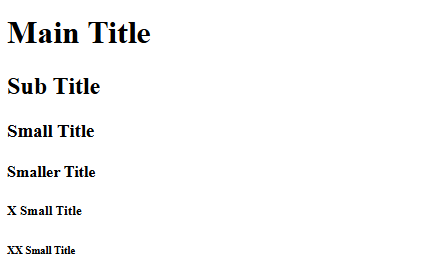
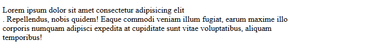
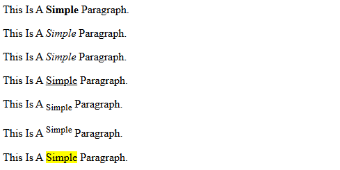
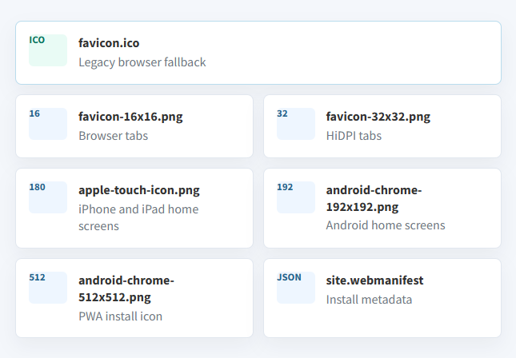

# GDG-Tasks

Here We Will Gonna See Your Tasks Guys

---

## The First Session (HTML)

- What Is HTML
- The Syntax Of HTML
- Elements and Tags
- Void Elements
- Links and Images
- Headings
- Paragraph
- Br And Hr
- class & id Attributes
- Text Formatting

---

## What Is HTML

HTML >> is called Hyper Text Markup Language

> its markup language not a programming language ok!

its the structure of building websites its the main thing nothing can work with out it.

---

## The Syntax Of HTML

``` html
<!DOCTYPE html>
<html>
<head>
</head>
<body>
</body>
</html>
```

---

## Elements and Tags

> Element :
> > < h1 > >>>> Opening Tag  
> > Main Title >>>> Content  
> > < h1 > >>>> Closing Tag
>
> Tag :
> > < h1 > >>>> Tag

---

## Void Elements

The Void Elements its Elements that Have No Closing Tag

---

## Links & Images

### Links

So We `<a>` Tag to Make A Hyper Links In Our Page.

|  Attribute  | Description                               |
|    :----:   |    :----:                                 |
| href        | This Is For Defining The Path             |
| target      | This Is For Defining Where The Page Opens |

``` html
     <a href="https://www.google.com" target="_blank">Link To Google</a>
     <a href="https://www.google.com" target="_self">Link To Google</a>
     <a href="https://www.google.com" target="_parent">Link To Google</a>
     <a href="https://www.google.com" target="_top">Link To Google</a>
```

|  Target     | Description                               |
|    :----:   |    :----:                                 |
| _blank      | Opens The Link In A New Tab               |
| _self       | Opens The Link In The Same Tab            |
| _parent     | Opens The Link In The Parent Frame        |
| _top        | Opens The Link In The Topmost Frame       |

### Images

So We `` Tag to Add Images In Our Page

|  Attribute  | Description                                   |
|    :----:   |    :----:                                     |
| src        | This Is For Defining The Path                 |
| alt         | This Is For Defining Description Of The Image |
| Width       | This Is For Defining The Width Of The Image   |
| height      | This Is For Defining The Height Of The Image  |

``` html
     
```

---

## Headings & Paragraph

### Headings

we use it to title our addresses in our website

```html
    <!-- Headings -->
     <h1>Main Title</h1> 
     <h2>Sub Title</h2> 
     <h3>Small Title</h3> 
     <h4>Smaller  Title</h4> 
     <h5>X Small Title</h5> 
     <h6>XX Small Title</h6>
     <!-- Headings We Use Them To Set A Title In Our Page -->
```



### Paragraph

We Use It To Describe Or Add Paragraph

```html
     <!-- Paragraph -->  
     <p>This Is A Simple Paragraph.</p>
     <!-- Paragraph We Use It To Describe Or Add Paragraph -->
```

---

## Br & Hr

### Hr

```html
<hr> <!-- Make A Horizontal Line Break -->
```

### Br

```html
     <!-- br -->

      <p>Lorem ipsum dolor sit amet consectetur adipisicing elit <br>. Repellendus, nobis quidem! Eaque commodi veniam illum fugiat, earum maxime illo <br> corporis numquam adipisci expedita at cupiditate sunt vitae voluptatibus, aliquam <br> temporibus!</p>

     <!-- br We Use To Wrap The Text That We Writing And Put It Into New Line -->
```



---

## class & id Attributes

Both `class` and `id` are HTML attributes used to identify elements, but they are used differently:

| `class`                                                    | `id`                                   |
|---                                                         | ---                                    |
| Can be shared by multiple elements.                        | Should be unique within the page.      |
| An element can have multiple classes, separated by spaces. | An element should have one `id` value. |
| Selected in CSS with `.class-name`.                        | Selected in CSS with `#id-name`.       |
| Example: `<p class="note">...</p>`                         | Example: `<p id="intro">...</p>`       |

---

## Text Formatting

| Tag        | What it does                                                                      | Example                           |
|  :---      |  :---                                                                             | :---                              |
| `<b>`      | Draws attention to text without adding importance.                                | `<b>Bold text</b>`                |
| `<strong>` | Marks text as important; browsers usually display it in bold.                     | `<strong>Important text</strong>` |
| `<i>`      | Marks text in an alternate voice or mood; browsers usually display it in italics. | `<i>Italic text</i>`              |
| `<em>`     | Emphasizes text; browsers usually display it in italics.                          | `<em>Emphasized text</em>`        |
| `<mark>`   | Highlights text as relevant.                                                      | `<mark>Highlighted text</mark>`   |
| `<small>`  | Marks side comments or fine print, usually in smaller text.                       | `<small>Fine print</small>`       |
| `<del>`    | Marks text that has been deleted.                                                 | `<del>Old text</del>`             |
| `<ins>`    | Marks text that has been added.                                                   | `<ins>New text</ins>`             |
| `<sub>`    | Displays text below the normal line, such as in a chemical formula.               | `H<sub>2</sub>O`                  |
| `<sup>`    | Displays text above the normal line, such as an exponent.                         | `x<sup>2</sup>`                   |

```html
     <!-- Text Formatting -->
     <p>This Is A <strong>Simple</strong> Paragraph.</p>
     <p>This Is A <em>Simple</em> Paragraph.</p>
     <p>This Is A <i>Simple</i> Paragraph.</p>
     <p>This Is A <ins>Simple</ins> Paragraph.</p>
     <p>This Is A <sub>Simple</sub> Paragraph.</p>
     <p>This Is A <sup>Simple</sup> Paragraph.</p>
     <p>This Is A <mark>Simple</mark> Paragraph.</p>
     <!-- Text Formatting We Use It To Format The Text In Our Page -->

```



---

## Favicon

This For Putting Icons For Our Website.



### Some Links

> <https://favicon.io/>        Need VPN
>
> <https://www.favicon.cc/>

```html
    <link rel="shortcut icon" href="favicon.ico" type="image/x-icon"> <!-- This For Adding Icon Or Favicon To Our Page -->
```

---

## File Paths

|  Relative Path                           | Absolute Path                                         |
|    :----:                                |    :----:                                             |
| Starts from the current file's location. | Specifies the complete address, including the domain. |
| `images/logo.png`                        | `https://example.com/images/logo.png`                 |

---
